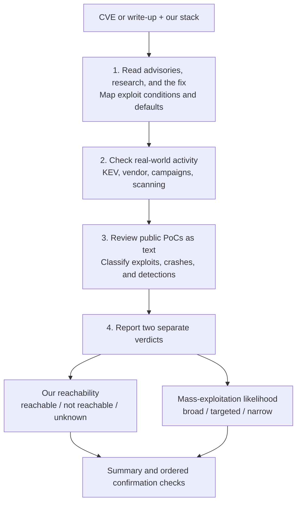

# CVE validation skill

The [`cve-validation` skill](cve-validation/SKILL.md) checks whether a vulnerability can reach **our deployment** and how likely it is to be exploited **at scale**. Invoke it with a CVE ID or the discovering team's write-up, plus the stack being assessed.

The key step is checking **every exploit condition**: access, input path, build and platform, configuration, effort, demonstrated impact, and patch state. Each condition needs evidence, its shipped default, and a way to check our deployment. An unknown reachability verdict includes a concrete confirmation sequence.

Reports follow the [report template](cve-validation/references/report-template.md). The [source guide](cve-validation/references/sources.md) lists where to look; the [product check](cve-validation/references/product-check.md) covers specific products that bundle a vulnerable component. Public PoCs are reviewed read-only and never executed.
